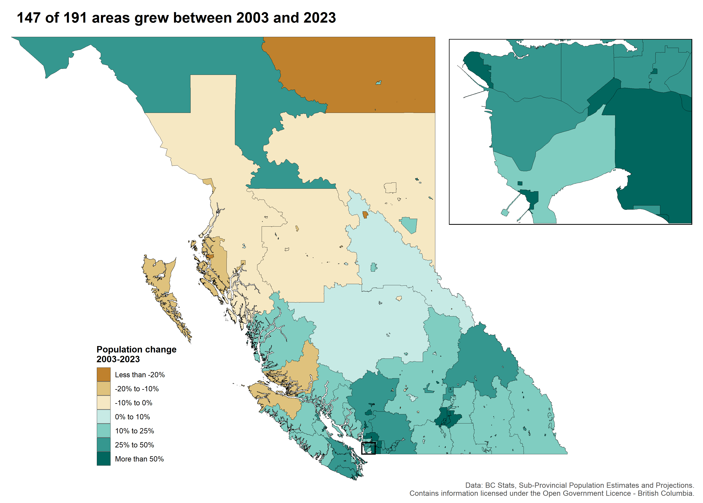
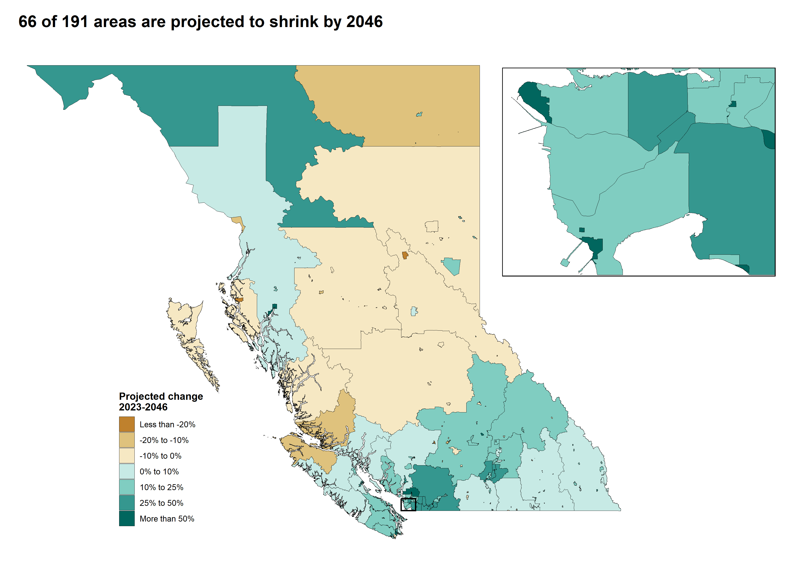

# BC population change maps

Two maps of percent population change in every BC municipality: estimated change from 2003 to 2023, and BC Stats' projection from 2023 to 2046. Each has an inset on Metro Vancouver.

> **Personal project.** This is my own analysis of publicly available data. It is not associated with my work for any current or past employer and does not represent their views.

## What it shows

- 147 of 191 areas grew between 2003 and 2023. Langford more than doubled (+160%). Most of the areas that lost people are small communities in the north and along the coast.
- Most of the growth in head count is still in Metro Vancouver. It gained 61% of BC's added residents from 2003 to 2023 and is projected to gain 65% of them by 2046.
- 66 of 191 areas are projected to shrink by 2046, across most of the north and the central interior.





## Data

[BC Sub-Provincial Population Estimates and Projections](https://catalogue.data.gov.bc.ca/dataset/bc-sub-provincial-population-estimates-and-projections), Municipalities (Census Subdivisions) table. `code.R` downloads it. Boundaries come from the [bcmaps](https://github.com/bcgov/bcmaps) package (2021 census subdivisions, clipped to the coastline).

I map percent change so a small town and a big city read on the same scale. Colours run brown for loss and teal for growth, centred on zero. Percentages swing more where few people live, as in the large unincorporated areas of the north.

Areas outside municipalities are published as one "Unincorporated Areas" total per regional district, so the script merges those census subdivisions into a single polygon per regional district before joining.

Contains information licensed under the [Open Government Licence – British Columbia](https://www2.gov.bc.ca/gov/content/data/policy-standards/open-data/open-government-licence-bc).

## Run it

```r
install.packages(c("sf", "bcmaps", "ggplot2", "dplyr", "cowplot"))
source("code.R")
```

The maps are written to `maps/`. The first run downloads the boundary files (a few minutes); bcmaps caches them after that.

## License

Code: [MIT](LICENSE).
